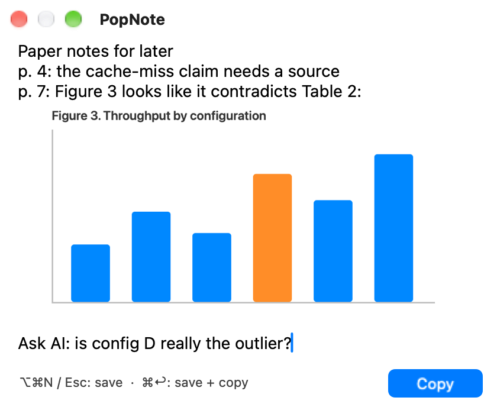

# PopNote

A note that's one keystroke away. Jot an idea down without leaving what you're doing, then hand it to an AI later.

**[Website →](https://kl-autonomous.github.io/PopNote/)**



## Keys

| | |
|---|---|
| **⌥⌘N** | Open a new note over everything, full-screen apps included. Press again to save and close. |
| **Esc** | Save and close. |
| **⌘↩** | Save, copy to clipboard (with images), and close. |
| Hold **⌃** and drag | Move the window from anywhere. |
| Double-click title bar | Fit the window to the note. |

Drag or paste images in. They show as small previews and are saved at full resolution.

Notes are Markdown files in `~/Documents/PopNote/`, with images in `attachments/`.

## Install

macOS 13 or later, with the Xcode Command Line Tools (`xcode-select --install`).

```bash
git clone https://github.com/kl-autonomous/PopNote.git
cd PopNote
./build.sh
open /Applications/PopNote.app
```

PopNote lives in the menu bar. Turn on **Launch at Login** there.

## License

[MIT](LICENSE)
