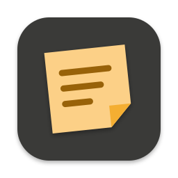

# PopNote

A note that's one keystroke away. Jot an idea down without leaving what you're doing, then hand it to an AI later.

**[Download for Mac](https://github.com/kl-autonomous/PopNote/releases/latest/download/PopNote.dmg)** · [Website](https://kl-autonomous.github.io/PopNote/)


## Keys

| | |
|---|---|
| **⌥⌘N** | Open a new note over everything, full-screen apps included. Press again to save and close. |
| **Esc** | Save and close. |
| **⌘↩** | Save, copy to clipboard (with images), and close. |
| Hold **⌃** and drag | Move the window from anywhere. |
| Double-click title bar | Fit the window to the note. |
| **⌘↑** / **⌘↓** | Flip through saved notes. The new note is kept while you look. |
| Hold **⌃**, click the lock | Keep the note on the current full-screen app instead of following you. |

Drag or paste images in. They show as small previews and are saved at full resolution.

Notes are Markdown files in `~/Documents/PopNote/`, with images in `attachments/`.

## Install

1. [Download PopNote.dmg](https://github.com/kl-autonomous/PopNote/releases/latest/download/PopNote.dmg), open it, and drag PopNote to Applications.
2. Open PopNote. macOS will block it the first time because it isn't notarized by Apple.
3. Go to **System Settings → Privacy & Security**, scroll down, and click **Open Anyway**. Only needed once.

PopNote lives in the menu bar. Turn on **Launch at Login** there. Requires macOS 13 or later.

### Build from source

Needs the Xcode Command Line Tools (`xcode-select --install`).

```bash
git clone https://github.com/kl-autonomous/PopNote.git
cd PopNote
./build.sh        # builds and installs to /Applications
./release.sh      # builds build/PopNote.dmg
```

## License

[MIT](LICENSE)
